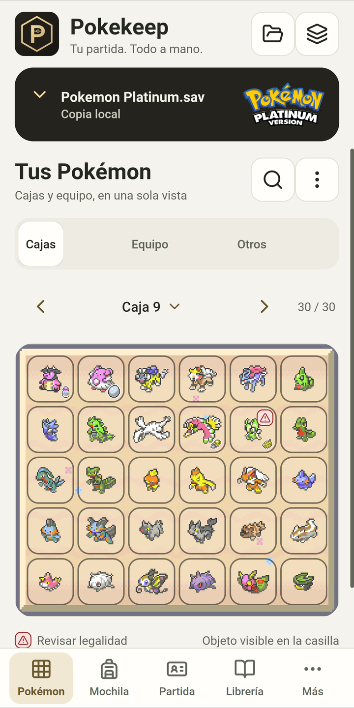
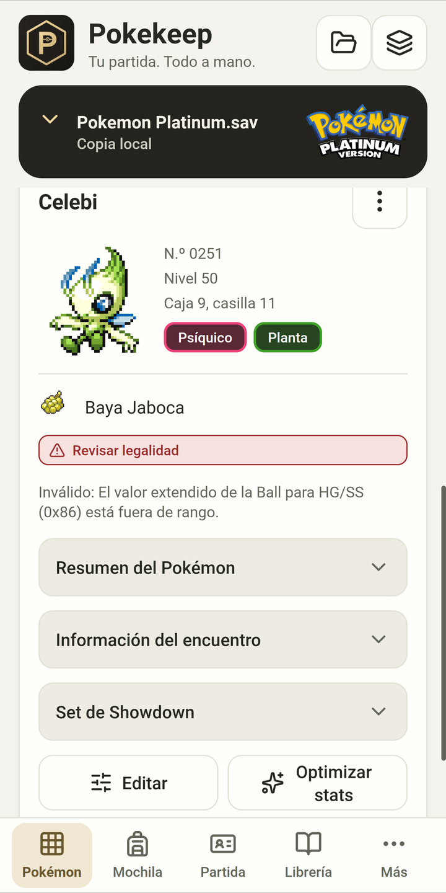
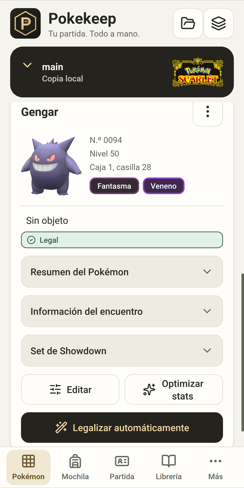
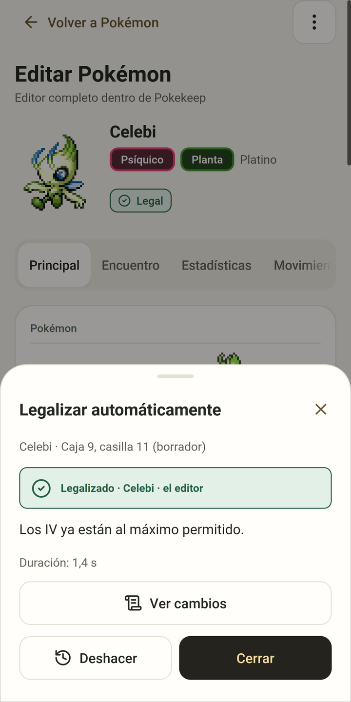
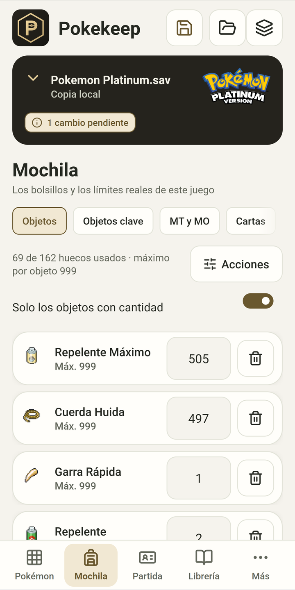
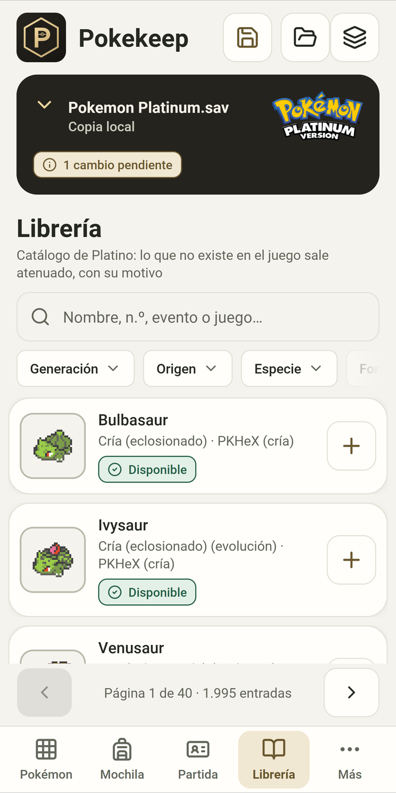
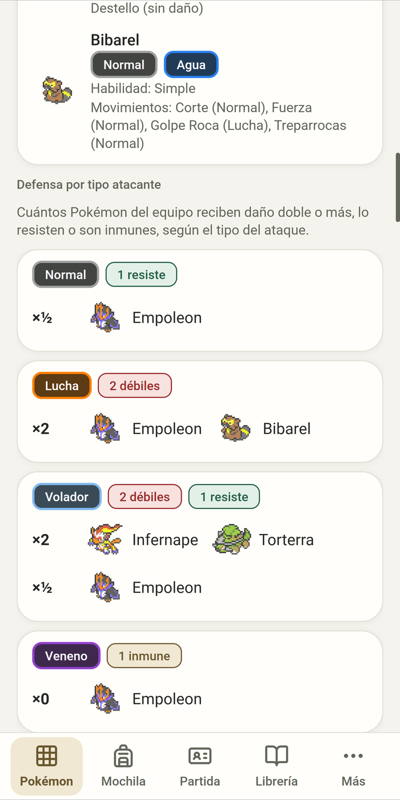
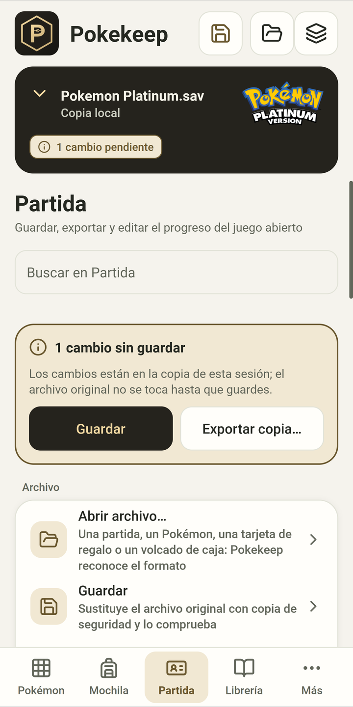

# Pokekeep

*[English](README.md)*

Pokekeep es un editor de partidas de Pokémon basado en [PKHeX](https://github.com/kwsch/PKHeX). Tiene dos versiones: una app para
Android y un PKHeX portable para Windows. Las dos añaden «Legalizar automáticamente», que deja legal un Pokémon conservando su
especie y, siempre que el juego lo permita, su variocolor, sexo, naturaleza y movimientos. Cada resultado se comprueba con el
análisis de legalidad de PKHeX antes de escribirlo en la partida.

La versión actual es la 1.0.1, del 26 de octubre de 2026. Web, vídeo y preguntas frecuentes: **[adriandelgadoalcalde-alt.github.io/Pokekeep](https://adriandelgadoalcalde-alt.github.io/Pokekeep/)**.

## Capturas de Android

| Cajas | Ficha | Vista 3D de Escarlata | Resultado de «Legalizar» |
|---|---|---|---|
|  |  |  |  |
| Mochila | Librería | Cobertura de tipos | Partida |
|  |  |  |  |

Las capturas usan partidas públicas de prueba de la colección RoC's PC (Platino y Escarlata).

## Qué hace

«Legalizar automáticamente» trabaja en dos pasos. Primero corrige solo lo que el análisis marca como inválido: movimientos, EV,
Ball, nivel, bytes de basura de los textos… Si con eso no basta, genera el Pokémon de nuevo desde un origen legal del mismo juego
y mantiene todo lo que puede. Al terminar enseña la lista de cambios y se puede deshacer. Si no hay forma de legalizarlo, el
Pokémon se queda como estaba y la app explica el motivo.

En Android, además:

- Cajas, equipo y «Otros» en una misma pantalla, con arrastrar y soltar, búsqueda, selección de varios Pokémon y un menú de caja
  para ordenar, vaciar o borrar huevos, clones e ilegales.
- El editor completo de cada Pokémon: datos, encuentro, estadísticas, movimientos, aspecto, entrenador, cintas y recuerdos.
- Edición masiva y «Completar el juego», con vista previa, progreso, cancelación e informe.
- La Librería, con todo lo que se puede conseguir en el juego de la partida, eventos incluidos.
- Mochila, datos de la partida, un banco de Pokémon propio y la cobertura de tipos del equipo.
- Las imágenes de cada juego: vistas previas e iconos de caja de la primera generación a Leyendas Z-A, huevos incluidos, con los
  tipos en los colores de Escarlata y Púrpura, más las carátulas, los logos y los gritos.
- Español de España e inglés, tema claro y oscuro, letra grande, TalkBack y el gesto de atrás de Android.

La versión de Windows es el propio PKHeX con dos botones más en el editor y en el menú de cada casilla («Legalizar
automáticamente» y «Optimizar stats»), una pestaña Librería y las operaciones masivas.

Las dos funcionan con todos los juegos que admite PKHeX 26.10.18, de Rojo y Azul a Leyendas Z-A, y no usan Internet.

## Qué significa «legal»

Pokekeep no modifica ninguna regla de legalidad de PKHeX: el que decide es el análisis de `PKHeX.Core`. «Legal» quiere decir que
PKHeX no encuentra nada inválido. No demuestra cómo se consiguió el Pokémon ni que existiera tal cual en una distribución real.

## Descargas

Las dos están en la página de **Releases** de este repositorio, con su SHA-256.

**Android.** `Pokekeep-1.0.1.apk`, para Android 10 o posterior. Ocupa unos 700 MB porque lleva las imágenes de todos los juegos.
Para instalarlo hay que permitir apps de origen desconocido al navegador o al gestor de archivos. Pide permiso de notificaciones y
de servicio en primer plano, para que las operaciones largas sigan aunque cambies de app. No pide acceso a Internet. Trabaja sobre
una copia de la partida y no escribe el archivo original hasta que guardas. También se puede instalar y actualizar con
[Obtainium](https://github.com/ImranR98/Obtainium): añade `https://github.com/adriandelgadoalcalde-alt/Pokekeep` como fuente.

**Windows.** `PKHeX-Pokekeep-1.0.1.zip`, para Windows 10 u 11 de 64 bits. Se descomprime y se abre `PKHeX.exe`; no hace falta
instalar nada, ni siquiera .NET.

¿Has encontrado un fallo o tienes una idea? [Abre una incidencia](https://github.com/adriandelgadoalcalde-alt/Pokekeep/issues/new/choose) o una
[conversación](https://github.com/adriandelgadoalcalde-alt/Pokekeep/discussions), en español o en inglés.

## Compilar desde el código

Este repositorio tiene el código y los scripts para construir los dos productos desde cero. PKHeX, PKHeX-Plugins (ALM) y los datos
de eventos y de Pokémon GO no están en Git: `fuentes.lock.json` fija cada uno por commit y un script los descarga. Todo se ejecuta en
Windows 10 u 11 de 64 bits, con Windows PowerShell 5.1 y desde la raíz del repositorio.

**Qué hace falta**

- Git.
- Para la versión de Windows, el SDK de .NET 10.0.401 (`global.json` lo fija, sin avance a versiones posteriores). Se comprueba con
  `dotnet --list-sdks`.
- Para Android, un JDK 21. Los scripts lo buscan en `C:\Program Files\Java\jdk-21.0.12`; si el tuyo está en otro sitio, define
  `POKEKEEP_JDK`. Lo demás de Android (un SDK de .NET aislado con la carga de trabajo de Android y el Android SDK) lo instala
  `entorno-android.ps1 -Instalar` dentro de `herramientas\`, sin tocar nada fuera de la carpeta salvo una unión corta en `%TEMP%`.
- Acceso a Internet durante la compilación, para bajar las fuentes y los paquetes NuGet. Las apps ya construidas no lo usan.
- Opcionalmente 7-Zip, solo para `-Zip` (se busca en el `PATH`, o se define `POKEKEEP_7ZIP`).

**1. Fuentes de terceros**

```powershell
powershell -NoProfile -ExecutionPolicy Bypass -File herramientas\obtener-fuentes.ps1
```

Hace un clon superficial de cada fuente en su commit fijado dentro de `fuentes\` y después ejecuta `herramientas\verificar-fuentes.ps1`.

**2. Windows (PKHeX portable)**

```powershell
powershell -NoProfile -ExecutionPolicy Bypass -File herramientas\construir-portable.ps1 -SinInforme
```

El resultado es la carpeta `distribucion\PKHeX-Pokekeep\`; con `-Zip` se obtiene además `distribucion\PKHeX-Pokekeep-1.0.1.zip`. El
script aplica los parches de `parches\` a PKHeX.WinForms, publica una versión autocontenida, construye la base de datos del catálogo
desde las fuentes fijadas y escribe un manifiesto SHA-256 de cada archivo. `PKHeX.Core.dll` se compila de forma determinista
(`CoreDeterminista.targets`): el mismo commit da el mismo archivo desde cualquier carpeta.

**3. Android (APK)**

```powershell
powershell -NoProfile -ExecutionPolicy Bypass -Command ". .\herramientas\entorno-android.ps1 -Instalar"
powershell -NoProfile -ExecutionPolicy Bypass -File herramientas\generar-sprites-android.ps1
powershell -NoProfile -ExecutionPolicy Bypass -File herramientas\generar-gritos-android.ps1 -SinPikachuUltrasol
powershell -NoProfile -ExecutionPolicy Bypass -File herramientas\generar-objetos-android.ps1 -SoloPaquete -SinPartidas
powershell -NoProfile -ExecutionPolicy Bypass -File herramientas\construir-bd-android.ps1 -SinCache
powershell -NoProfile -ExecutionPolicy Bypass -File herramientas\compilar-apk.ps1 -Rid android-arm64
```

Por orden: las herramientas de Android; el paquete de sprites, sacado de los recursos del propio PKHeX; los paquetes de gritos y de
iconos de objetos adicionales, que se descargan de PokeAPI en revisiones fijadas (procedencia en `NOTICE.md` y `docs\android\`); el
catálogo y la identidad de los binarios de Android, que queda en `datos\android\identidad.json`; y el APK. `compilar-apk.ps1` se
detiene si el motor del APK no es aquel para el que se construyeron los datos. El APK queda en
`android\Pokekeep.Mobile\bin\Release\net10.0-android\android-arm64\`; con `-Salida <archivo>` se copia a otro sitio. Para un
emulador, `-Rid android-x64`.

**Lo que no trae una compilación desde el código**

- La caché de soluciones precalculadas. Se produce con un banco de pruebas que no se publica, así que `-SinCache` la deja fuera y el
  motor calcula las soluciones sobre la marcha, algo más despacio en algunos encuentros.
- Las imágenes sacadas de las copias de los juegos del autor (vistas previas e iconos de caja de las generaciones 1 a 5, renders 3D,
  carátulas y logos de título). No están en el repositorio y ningún script de aquí las genera. Sin ellas, la app usa los sprites de
  PKHeX.
- El grito de Pikachu. La release usa el audio de un juego que posee el autor; la compilación desde el código usa el grito de
  PokeAPI, como el resto de especies (`-SinPikachuUltrasol`).
- Los iconos de objetos de Pokémon Colosseum y de Leyendas: Arceus. Su mochila solo se lee de una partida real y no se publican
  partidas (`-SinPartidas` deja fuera esos dos juegos). Los PNG de objetos se empaquetan sin el paso de compactación sin pérdida,
  así que ocupan algo más.
- Las comprobaciones de la release (auditoría de firma y SBOM del APK, e informe de cobertura), que dependen de herramientas del autor.

Todos los datos, paquetes y resultados acaban en carpetas que `.gitignore` deja fuera de Git (`fuentes\`, `datos\`, `compilacion\`,
`distribucion\`).

## Créditos y licencia

Pokekeep lo diseña y desarrolla IncrediBad sobre PKHeX, de Kurt «kwsch» y colaboradores. La lista completa está en
[`CREDITOS.md`](CREDITOS.md) y las licencias y procedencias, en [`NOTICE.md`](NOTICE.md).

El código se publica bajo la GNU GPL v3.0 o posterior (`LICENSE`), la misma licencia que PKHeX.

Pokémon, sus nombres, imágenes y sonidos son de Nintendo, Creatures Inc. y GAME FREAK inc. Pokekeep no es oficial ni está
afiliado a ellos. No incluye ROMs, claves ni partidas.
