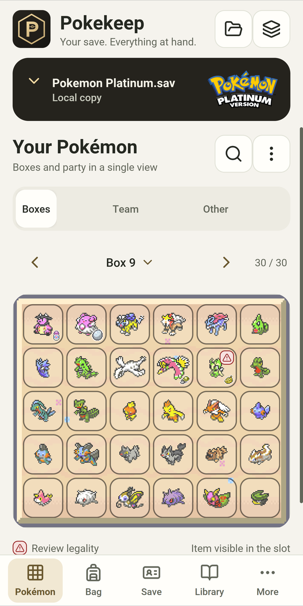
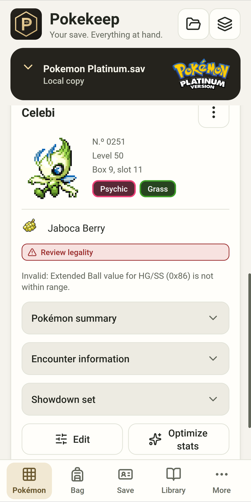
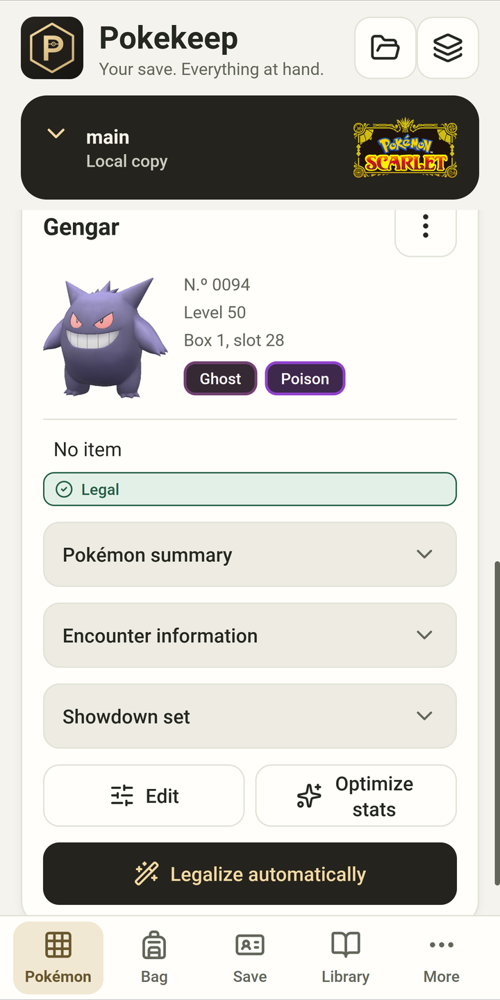
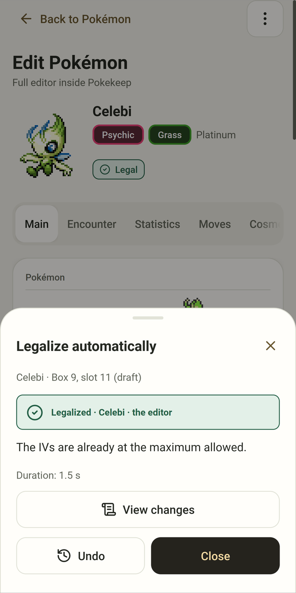
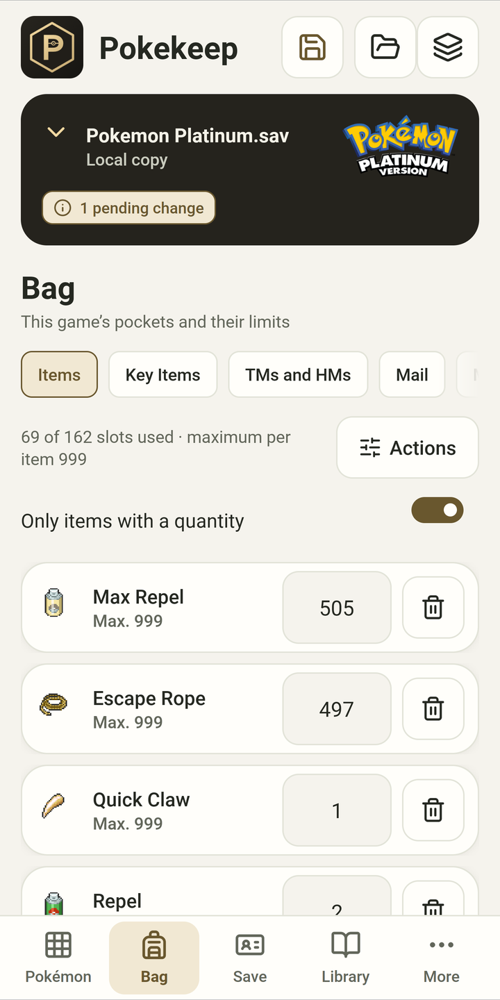
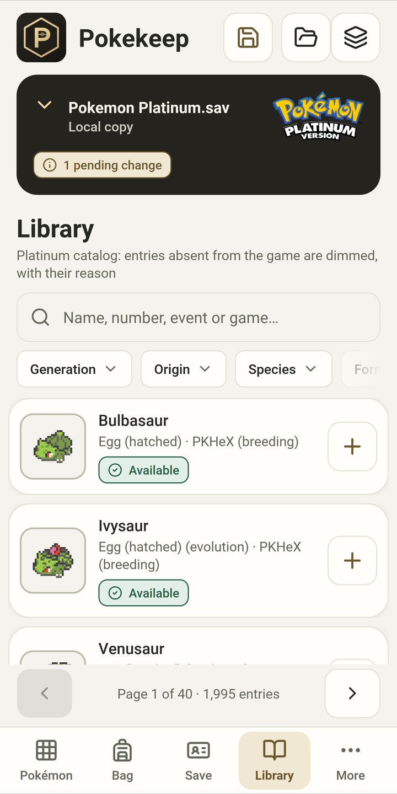
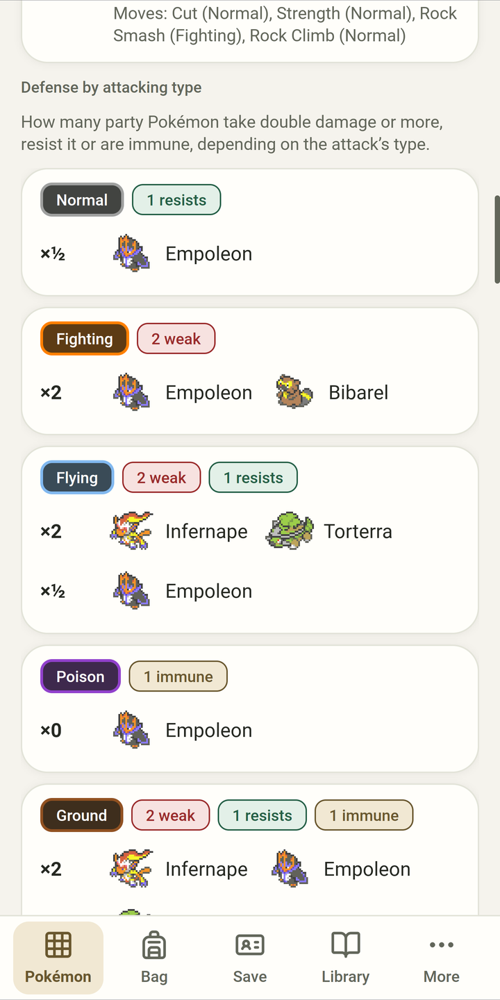
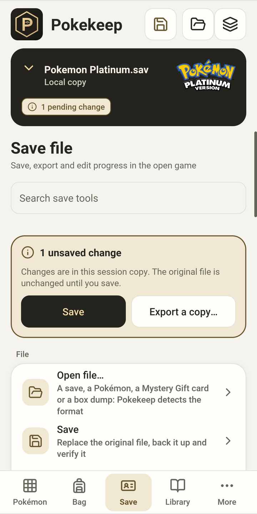

# Pokekeep

*[Español](README.es.md)*

Pokekeep is a Pokémon save editor built on [PKHeX](https://github.com/kwsch/PKHeX). It comes in two versions: an Android app and a
portable PKHeX for Windows. Both add “Legalize automatically”, which makes a Pokémon legal while keeping its species and, whenever
the game allows it, its shininess, gender, nature and moves. Every result is checked with PKHeX’s legality analysis before it is
written to the save.

The current version is 1.0.1, released on 26 October 2026. Website, video and FAQ: **[adriandelgadoalcalde-alt.github.io/Pokekeep](https://adriandelgadoalcalde-alt.github.io/Pokekeep/)**.

## Android screenshots

| Boxes | Pokémon details | Scarlet 3D preview | “Legalize” result |
|---|---|---|---|
|  |  |  |  |
| Bag | Library | Type coverage | Save file |
|  |  |  |  |

The screenshots use public test saves from the RoC's PC collection (Platinum and Scarlet).

## What it does

“Legalize automatically” works in two steps. First it fixes only what the analysis marks as invalid: moves, EVs, Ball, level, trash
bytes in the texts… If that is not enough, it generates the Pokémon again from a legal origin in the same game and keeps everything
it can. When it finishes it lists the changes, and you can undo them. If the Pokémon cannot be made legal, it is left as it was and
the app explains why.

On Android you also get:

- Boxes, party and “Other” on one screen, with drag and drop, search, multi-selection and a box menu to sort, clear, or delete eggs,
  clones and illegal Pokémon.
- The full editor for each Pokémon: data, encounter, stats, moves, appearance, trainer, ribbons and memories.
- Bulk edit and “Complete the game”, with preview, progress, cancel and a report.
- The Library, with everything obtainable in the save’s game, events included.
- Bag, save data, your own Pokémon bank and the type coverage of your party.
- Images from each game: previews and box icons from the first generation to Legends: Z-A, eggs included, types in Scarlet and
  Violet colors, plus box art, logos and cries.
- Spanish (Spain) and English, light and dark themes, large text, TalkBack and the Android back gesture.

The Windows version is PKHeX itself with two more buttons in the editor and in each slot’s menu (“Legalize automatically” and
“Optimize stats”), a Library tab and the bulk operations.

Both work with every game PKHeX 26.10.18 supports, from Red and Blue to Legends: Z-A, and neither uses the Internet.

## What “legal” means

Pokekeep does not change any of PKHeX’s legality rules: `PKHeX.Core`’s analysis decides. “Legal” means PKHeX finds nothing invalid.
It does not prove how the Pokémon was obtained, or that it existed exactly like that in a real distribution.

## Downloads

Both are on this repository’s **Releases** page, with their SHA-256.

**Android.** `Pokekeep-1.0.1.apk`, for Android 10 or later. It is about 700 MB because it carries the images of every game. To
install it, allow your browser or file manager to install unknown apps. It asks for notifications and a foreground service, so long
operations keep running if you switch apps. It does not ask for Internet access. It works on a copy of the save and does not write
the original file until you save. You can also install and update it with [Obtainium](https://github.com/ImranR98/Obtainium): add
`https://github.com/adriandelgadoalcalde-alt/Pokekeep` as a source.

**Windows.** `PKHeX-Pokekeep-1.0.1.zip`, for 64-bit Windows 10 or 11. Unzip it and open `PKHeX.exe`; nothing needs to be installed,
not even .NET.

Found a bug or have an idea? [Open an issue](https://github.com/adriandelgadoalcalde-alt/Pokekeep/issues/new/choose) or start a
[discussion](https://github.com/adriandelgadoalcalde-alt/Pokekeep/discussions), in English or Spanish.

## Building from source

This repository has the code and the scripts to build both products from scratch. PKHeX, PKHeX-Plugins (ALM) and the event and
Pokémon GO data are not in Git: `fuentes.lock.json` pins each one by commit and a script downloads them. Run everything on Windows 10
or 11 (64-bit) with Windows PowerShell 5.1, from the repository root.

**You need**

- Git.
- For the Windows version, the .NET SDK 10.0.401 (`global.json` pins it, with no roll-forward). Run `dotnet --list-sdks` to check.
- For Android, a JDK 21. The scripts look for `C:\Program Files\Java\jdk-21.0.12`; if yours is somewhere else, set `POKEKEEP_JDK`.
  Everything else for Android (an isolated .NET SDK with the Android workload, and the Android SDK) is installed by
  `entorno-android.ps1 -Instalar` inside `herramientas\`, nothing outside the folder except a short junction in `%TEMP%`.
- Internet access during the build, to fetch the sources and the NuGet packages. The built apps do not use it.
- Optionally 7-Zip, only for `-Zip` (found in the `PATH`, or set `POKEKEEP_7ZIP`).

**1. Third-party sources**

```powershell
powershell -NoProfile -ExecutionPolicy Bypass -File herramientas\obtener-fuentes.ps1
```

It makes a shallow clone of each source at its pinned commit into `fuentes\` and then runs `herramientas\verificar-fuentes.ps1`.

**2. Windows (portable PKHeX)**

```powershell
powershell -NoProfile -ExecutionPolicy Bypass -File herramientas\construir-portable.ps1 -SinInforme
```

The result is the folder `distribucion\PKHeX-Pokekeep\`; add `-Zip` to also get `distribucion\PKHeX-Pokekeep-1.0.1.zip`. The script
applies the patches in `parches\` to PKHeX.WinForms, publishes a self-contained build, builds the catalog database from the pinned
sources and writes a SHA-256 manifest of every file. `PKHeX.Core.dll` is compiled deterministically (`CoreDeterminista.targets`): the
same commit gives the same file from any folder.

**3. Android (APK)**

```powershell
powershell -NoProfile -ExecutionPolicy Bypass -Command ". .\herramientas\entorno-android.ps1 -Instalar"
powershell -NoProfile -ExecutionPolicy Bypass -File herramientas\generar-sprites-android.ps1
powershell -NoProfile -ExecutionPolicy Bypass -File herramientas\generar-gritos-android.ps1 -SinPikachuUltrasol
powershell -NoProfile -ExecutionPolicy Bypass -File herramientas\generar-objetos-android.ps1 -SoloPaquete -SinPartidas
powershell -NoProfile -ExecutionPolicy Bypass -File herramientas\construir-bd-android.ps1 -SinCache
powershell -NoProfile -ExecutionPolicy Bypass -File herramientas\compilar-apk.ps1 -Rid android-arm64
```

In order: the Android toolchain; the sprite pack taken from PKHeX’s own resources; the cry and extra item-icon packs, downloaded from
PokeAPI at pinned revisions (provenance in `NOTICE.md` and `docs\android\`); the catalog and the identity of the Android binaries,
saved in `datos\android\identidad.json`; and the APK. `compilar-apk.ps1` stops if the engine in the APK is not the one the data was
built for. The APK is left in `android\Pokekeep.Mobile\bin\Release\net10.0-android\android-arm64\`; use `-Salida <file>` to copy it.
For an emulator, use `-Rid android-x64`.

**What a build from source does not include**

- The cache of precomputed solutions. It is produced with a test bench that is not published, so `-SinCache` leaves it out and the
  engine works the solutions out on demand, which is slower for some encounters.
- The images taken from the author’s own game copies (previews and box icons for generations 1 to 5, 3D renders, box art and
  title logos). They are not in the repository and no script here makes them. Without them the app uses PKHeX’s sprites.
- Pikachu’s cry. The release uses audio from a game the author owns; the build from source uses PokeAPI’s cry, like every other
  species (`-SinPikachuUltrasol`).
- Item icons for Pokémon Colosseum and Legends: Arceus. Their bag can only be read from a real save, and no saves are published
  (`-SinPartidas` leaves those two games out). The item PNG files are packed without the lossless compaction step, so they take a
  little more space.
- The release checks (signature audit and SBOM of the APK, and the coverage report), which depend on tools of the author.

All the data, packs and builds end up in folders that `.gitignore` leaves out of Git (`fuentes\`, `datos\`, `compilacion\`,
`distribucion\`).

## Credits and license

Pokekeep is designed and developed by IncrediBad on top of PKHeX, by Kurt “kwsch” and contributors. The full list is in
[`CREDITS.md`](CREDITS.md), and the licenses and provenance in [`NOTICE.md`](NOTICE.md).

The code is released under the GNU GPL v3.0 or later (`LICENSE`), the same license as PKHeX.

Pokémon and its names, images and sounds belong to Nintendo, Creatures Inc. and GAME FREAK inc. Pokekeep is not official and is not
affiliated with them. It includes no ROMs, keys or saves.
